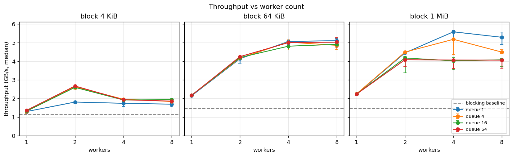
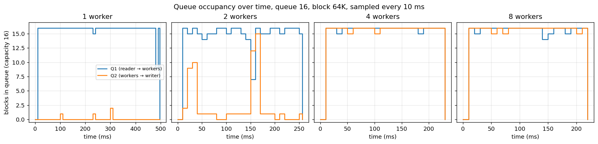
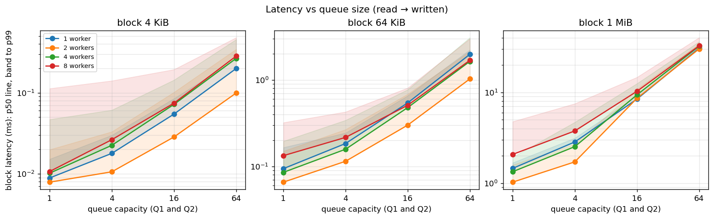
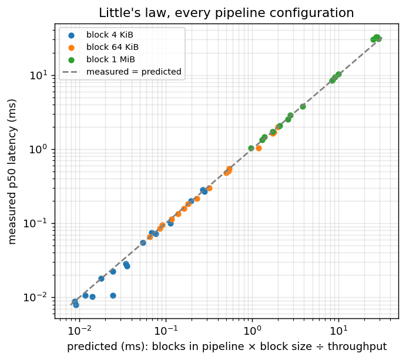
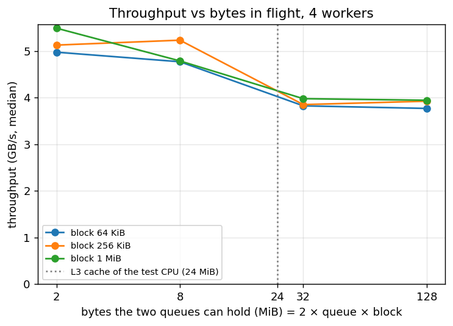
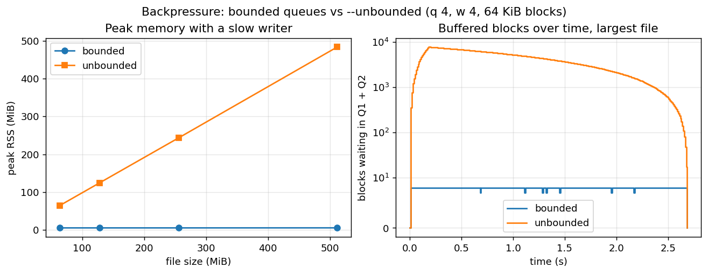
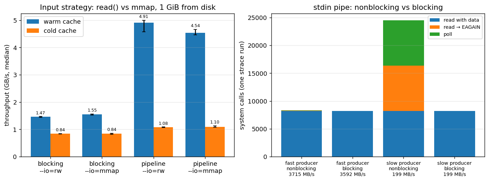

# pipe-chunk

[](https://github.com/owenng71/pipe-chunk/actions/workflows/ci.yml)

A parallel file copier in C11 and POSIX threads, built to study **bounded buffers, backpressure and
robust I/O** on Linux.

A **reader** thread splits the input into fixed-size blocks, **worker** threads compute a SHA-256
checksum for each block, and a **writer** thread `pwrite`s every block to its offset in the output
and records `seq,offset,len,sha256` in a manifest. Bounded queues and a fixed buffer pool keep memory
constant when one stage is slower than the others. The copy must stay correct under partial reads
and writes, interrupted system calls, a slow output device, a crashing worker and Ctrl+C.

> **Status: in development.** The concurrent pipeline with backpressure, the blocking baseline,
> rate limiting, metrics, I/O fault injection, worker-failure recovery, graceful Ctrl+C,
> nonblocking stdin input and `mmap` input are checked in CI, including an end-to-end fault matrix. Benchmarks and their analysis are in [Results](#results).
> See [Roadmap](#roadmap).

---

## Architecture

```
            ┌──────────── buffer pool (fixed number of trays) ◀────────────┐
            ▼                                                              │
 input ─▶ Reader ─▶ [ Q1: bounded ] ─▶ Workers ×N ─▶ [ Q2: bounded ] ─▶ Writer ─▶ output + manifest
                                       (SHA-256)                       (pwrite at offset)
                                           ▲
                                       Supervisor (respawns a dead worker, re-queues its block)
```

**Backpressure.** If the writer is slow, Q2 fills and workers block; then Q1 fills and the reader
blocks. Every stage runs at the speed of the slowest one, and data memory never exceeds
`trays × block_size`. `--unbounded` turns this off to show memory growing without flow control.

**Buffer ownership.** A block (`record_t`) is owned by exactly one stage at a time and only its
pointer moves between stages, never the data:

| Step | Ownership |
|---|---|
| `pool_get()` | pool → reader |
| `bq_push(Q1)` / `bq_pop(Q1)` | reader → Q1 → worker |
| `bq_push(Q2)` / `bq_pop(Q2)` | worker → Q2 → writer |
| `pool_put()` after `pwrite` + manifest line | writer → pool |
| `--io=mmap`: reader points `buf` into the mapped input instead of reading into the tray | data is never copied; `pool_get` gives the tray its own buffer back |
| worker dies holding a block | supervisor → replacement worker (retry, at most `MAX_ATTEMPTS` tries) |

**Correctness without reordering.** Workers finish out of order. The writer uses `pwrite` at each
block's offset (idempotent) and keeps a bitmap of written sequence numbers, so a retried block is
never written or listed twice.

**Shutdown.** At end of input: close Q1 → workers drain and exit → close Q2 → writer drains →
`fsync`. The first Ctrl+C stops reading and finishes every accepted block (exit code 130); a second
Ctrl+C stops immediately.

**Robust I/O.** Every `read`/`write` goes through one module (`io.c`) that retries short counts,
`EINTR` and `EAGAIN`. Fault injection (`--fault-*`, `--fail-worker`) forces those paths in tests.

**`mmap` input.** With `--io=mmap` the input file is mapped once, read-only, and each block points
into the mapping, so workers hash and the writer `pwrite`s with no copy. Trays still limit how many
blocks are in flight. Peak RSS includes the mapped file pages that were touched (clean page cache the
kernel can drop), so it reaches the file size even though backpressure still holds. If another
program truncates the input mid-copy, the process gets `SIGBUS`; `read()` would only see an early EOF.

---

## Build

Requirements: Linux (Ubuntu 24.04 tested), gcc, make, OpenSSL `libcrypto`.

```sh
git clone https://github.com/owenng71/pipe-chunk.git
cd pipe-chunk
./scripts/setup.sh        # installs build-essential, libssl-dev, python3 (uses sudo)
make                      # builds build/pipe-chunk
```

On Windows, use WSL 2 with Ubuntu 24.04 and clone into the Linux home directory, not `/mnt/c`.

## Usage

```sh
./scripts/gen_input.sh 100M /tmp/in.bin                         # random 100 MB test file
./build/pipe-chunk -w 4 -q 16 -b 64K /tmp/in.bin /tmp/out.bin    # writes out.bin + out.bin.manifest
./scripts/verify.sh /tmp/in.bin /tmp/out.bin                    # prints VERIFY OK or VERIFY FAIL
```

Every run ends with a one-line summary on stderr:

```
pipe-chunk: 1073741824 bytes in 16384 blocks, 0.507 s, 2118.1 MB/s; latency p50 655 us, p99 1038 us;
cpu user 0.525 s, sys 0.567 s; peak RSS 7168 KiB; I/O calls 0.408 s
```

`--metrics=PREFIX` also writes `PREFIX.summary.csv` (the same numbers) and `PREFIX.occupancy.csv`
(queue sizes sampled every 10 ms).

`verify.sh` passes only if the output is byte-identical to the input and the manifest lists every
block exactly once with no gaps or overlaps.

| Option | Meaning |
|---|---|
| `-b, --block-size=BYTES` | block size, `K`/`M`/`G` suffixes allowed (default 64 KiB) |
| `-q, --queue=N` | capacity of Q1 and Q2 (default 16) |
| `-w, --workers=N` | worker threads (default 4) |
| `--mode=blocking\|pipeline` | single-threaded baseline, or the concurrent pipeline (default) |
| `--io=rw\|mmap` | read input with `read()` into pool buffers, or `mmap` it and hash and write straight from the mapping (regular files only) |
| `--unbounded` | disable backpressure (memory-growth demonstration) |
| `--stdin-blocking` | keep a stdin pipe blocking instead of `O_NONBLOCK` + `poll()` (for comparison) |
| `--in-rate`, `--out-rate=MB/s` | throttle the reader or the writer |
| `--fault-short`, `--fault-eintr`, `--fault-eagain=P` | inject short I/O, `EINTR`, `EAGAIN` with probability P |
| `--fault-delay-us=US`, `--fail-worker=P`, `--seed=N` | extra I/O delay, worker crashes, reproducible fault runs |
| `--manifest=FILE`, `--metrics=PREFIX` | manifest path; write summary and queue-occupancy CSVs |

`INPUT` may be `-` to read from stdin. A pipe or socket on stdin is switched to `O_NONBLOCK` for the
run: when the producer is slow, `read` returns `EAGAIN` and the reader waits in `poll()`. The
original flags are restored at the end. `--stdin-blocking` leaves the pipe blocking, so `read` sleeps in
the kernel instead. A terminal or redirected file is read as it is. Run
`./build/pipe-chunk --help` for the full list.

## Testing

| Command | What it runs |
|---|---|
| `make test` | every unit test in `tests/` |
| `make SAN=thread test` | the same under ThreadSanitizer (data races) |
| `make SAN=address test` | the same under AddressSanitizer (memory errors and leaks) |
| `./tests/e2e.sh [BINARY]` | end-to-end copies in both modes (100 MiB, empty, uneven sizes, many worker/queue/block settings, unbounded, slow input, stdin pipe, `mmap`), a fault matrix (short I/O, `EINTR`, `EAGAIN`, delays, dying workers, Ctrl+C drain and hard stop, each in several modes), each checked by `verify.sh`, plus a backpressure check: with a slow writer, bounded mode must stay under 32 MB while `--unbounded` grows |

The I/O unit test replaces `read` and `pwrite` with scripted versions to force short counts,
`EINTR`, `EAGAIN` and zero-byte writes deterministically, and also uses real signals and
nonblocking pipes. CI runs the unit tests and `e2e.sh` for the plain, ThreadSanitizer and
AddressSanitizer builds on every push. If ThreadSanitizer aborts with `unexpected memory mapping` on
Ubuntu 24.04, run `sudo sysctl vm.mmap_rnd_bits=28` once per boot.

## Benchmarks

```sh
make && ./bench/sweep.sh            # queue x workers x block size, about 4 minutes
./bench/memory.sh                   # bounded vs --unbounded with a slow writer, about 35 s
./bench/io.sh                       # rw vs mmap (cold/warm cache), blocking vs nonblocking pipe
./bench/plot.py                     # graphs in bench/results/plots/ (needs python3-matplotlib)
```

`bench/sweep.sh` copies a 1 GiB file with every combination of queue size {1, 4, 16, 64}, workers
{1, 2, 4, 8} and block size {4K, 64K, 1M}, plus the blocking baseline for each block size, 5 runs
each. Every run is checked with `verify.sh`. Runs go round-robin over the configurations so drift on
the machine does not bias one of them. Input and output live in `/dev/shm` (RAM), so the sweep
measures CPU and synchronization costs rather than the disk: on an SSD, flushing each 1 GiB copy
made the same configuration vary 2–3× between runs. Set `WORK=DIR` to run on a disk instead.
Results go to `bench/results/`:

| File | Contents |
|---|---|
| `sweep.csv` | one row per configuration: median throughput, p50/p99 latency, CPU, peak RSS, I/O time, and min/max throughput |
| `sweep_raw.csv` | one row per run |
| `occupancy/*.csv` | queue sizes every 10 ms for the first run of each pipeline configuration |
| `sweep_env.txt` | CPU, governor, kernel, compiler, commit and settings |

`bench/inflight.sh` repeats the sweep for 64K, 256K and 1M blocks with queue sizes chosen so the
queues hold the same number of bytes (2–128 MiB) for every block size.

`SIZE`, `RUNS`, `QUEUES`, `WORKERS`, `BLOCKS` and `OUT` override the defaults, e.g.
`QUEUES="4 16" WORKERS="2 4"`.

`bench/memory.sh` limits the writer to 200 MB/s and copies 64–512 MiB files with `-q 4 -w 4 -b 64K`,
bounded and `--unbounded`, 3 runs each, into `memory.csv` and `occupancy/memory_*.csv`.
`bench/io.sh` compares the input strategies. `--io=rw` and `--io=mmap` read a 1 GiB file from disk
with the page cache warm and cold, in both modes; the file is dropped from the cache with
`dd iflag=nocache` (no root needed) and `fincore` confirms the state before each run. A stdin pipe is
read nonblocking and with `--stdin-blocking`, fed by `cat` or a producer limited to 200 MB/s; one
extra run under `strace` counts `read`, `EAGAIN` and `poll`. Results: `io_input.csv`, `io_pipe.csv`.

`bench/plot.py` draws throughput vs workers, latency vs queue size, queue occupancy over time
(which stage is the bottleneck), peak memory bounded vs unbounded, and the I/O comparison.

## Results

Measured on an Intel Core i7-13620H (6 performance + 4 efficiency cores, 16 threads, 24 MiB L3
cache), 16 GB RAM, Ubuntu 22.04, kernel 6.8, gcc 11.4, at commit `04a7d80`. A 1 GiB file, median of
5 runs, copies in RAM (`/dev/shm`) unless stated otherwise. Other machines will give other numbers;
the commands above regenerate everything.

| Configuration (64 KiB blocks unless stated) | Throughput |
|---|---|
| Blocking baseline (one thread reads, hashes, writes) | 1.47 GB/s |
| Pipeline, 1 worker | 2.15 GB/s |
| Pipeline, 4 workers, queue 4 | 5.02 GB/s (3.4× the baseline) |
| Best overall: 1 MiB blocks, queue 1, 4 workers | 5.58 GB/s |

### Workers: faster until the writer is the bottleneck



One worker runs at 2.15 GB/s, the speed of SHA-256 on one core of this CPU (2.31 GB/s in
`openssl speed`). It already beats the baseline because reading and writing now overlap with
hashing. Two workers double it, four reach about 5 GB/s, and eight add nothing. The queue occupancy
shows why: the queue in front of the slowest stage is full and the one behind it is empty.



With 1 or 2 workers, Q1 is full and Q2 nearly empty: hashing is the bottleneck and backpressure keeps the
reader waiting. From 4 workers on, both queues are full: the single writer is the bottleneck, so more
workers cannot help. With 4 KiB blocks the pipeline peaks at 2.6–2.7 GB/s with 2 workers and then gets
slower. A 1 GiB file is 262,144 such blocks, each handed over twice through a lock and a condition
variable; with 8 workers the kernel time doubles (1.2 s vs 0.6 s) as threads contend for the same two
queues.

### Queue size: more waiting, not more speed



Once the stages are balanced, a larger queue does not raise throughput: with 64 KiB blocks and one
worker it stays at 2.15–2.18 GB/s from queue 1 to 64, while the median latency of a block grows from
0.09 ms to 1.98 ms. The queues stay full, so every new block waits behind all the blocks already
queued. This is Little's law: latency = blocks in the pipeline ÷ blocks per second. Using the measured
mean queue occupancy, it predicts the measured median latency of all 48 configurations: the median
ratio of measured to predicted is 0.99, and 80% of configurations are within 13%:



### Bytes in flight and the CPU cache



Big queues of big blocks are also slower: 1 MiB blocks reach 5.58 GB/s with queue 1 but about
4.0 GB/s with queue 16 or 64. The cause is the number of bytes in flight, not the block size: with
64K, 256K or 1M blocks alike, throughput falls from 4.8–5.5 GB/s to 3.8–4.0 GB/s between 8 and
32 MiB that the queues can hold, around the CPU's 24 MiB last-level cache. Beyond that, a block has
left the cache by the time the next stage reads it.

### Backpressure keeps memory flat



With the writer limited to 200 MB/s, the bounded pipeline peaks at 5.6–5.8 MiB for every file size
from 64 to 512 MiB. With `--unbounded`, the reader finishes the 512 MiB file in about 0.2 s and
memory grows to 483 MiB, nearly the whole file, then drains at the writer's pace. Both copies take
the same time (199.8 MB/s): the extra memory buys nothing, and a block waits up to 2.5 s (p99) instead
of 4.6 ms.

### Input strategies



- **`read()` vs `mmap`, warm cache:** `mmap` saves the copy from the page cache into a buffer, which
  helps the single-threaded baseline (1.55 vs 1.47 GB/s). The pipeline is 8% slower with `mmap`
  (4.54 vs 4.91 GB/s): the saved copy was the reader's, which is not the bottleneck, while every
  4 KiB page now costs a page fault in a worker. `mmap`'s peak RSS is about 1 GiB because touched
  file pages count in RSS; they are clean page-cache pages, not allocations.
- **Cold cache** (file dropped from the page cache before each run): the reader now waits for the
  SSD and the pipeline runs at 1.1–1.5 GB/s, still about 1.27× the baseline because reading overlaps
  with hashing and writing. `read()` and `mmap` are equal within 6%. The absolute cold numbers varied
  by up to 40% between sessions on this laptop's SSD while the ratios held, so only the ratios are
  reported.
- **Stdin pipe:** with a fast producer the pipe is almost always full and both modes run at
  3.6–3.7 GB/s. With a producer limited to 200 MB/s, the nonblocking reader finds the pipe empty for
  almost every block: 16,364 `read` calls (8,164 returning `EAGAIN`) and 8,164 `poll` calls, against
  8,200 `read` calls with `--stdin-blocking`. The speed and CPU time are the same. Nonblocking input
  buys control, not speed: the reader is never stuck inside `read()` and could wait on several inputs
  or a timeout.

### Takeaways

- Choose the worker count by the slowest stage: here hashing needs 2–4 workers before the single
  writer becomes the limit.
- Keep queues small. Queue 4 with 64 KiB blocks reaches the throughput plateau with 0.16 ms median
  latency and under 6 MiB of memory; larger queues only add latency and, past the cache size,
  lose throughput.
- Very small blocks cost more in synchronization than in work; 64 KiB–1 MiB blocks amortize it.
- Without backpressure, memory and latency grow with the input while throughput stays the same.

## Repository layout

| Path | Contents |
|---|---|
| `src/main.c` | command-line parsing and mode selection |
| `src/pipeline.c` | thread wiring, supervisor, shutdown order (`--mode=pipeline`) |
| `src/baseline.c` | single-threaded reference implementation (`--mode=blocking`) |
| `src/queue.c` | bounded blocking queue: ring buffer, mutex, `not_full`/`not_empty` condition variables |
| `src/pool.c` | fixed pool of pre-allocated block buffers |
| `src/io.c` | `read_full` / `pwrite_full`, the only place that calls `read`/`write`; times every call |
| `src/files.c` | opening input (nonblocking stdin pipe or `mmap`), output and manifest; block reads; manifest lines; sync and close |
| `src/seqset.c` | growable bitmap of written block numbers: the writer drops a repeated block |
| `src/faults.c` | fault injection for `io.c` (`--fault-*`, `--seed`) |
| `src/cancel.c` | `sigwait` signal thread: first Ctrl+C drains, second stops at once |
| `src/ratelimit.c` | pacing for `--in-rate` / `--out-rate` (slow-device simulation) |
| `src/metrics.c` | latency percentiles, queue-occupancy monitor thread, CPU, peak RSS, I/O time, CSV |
| `src/common.h` | `record_t` (one block in transit) and `config_t` (all options) |
| `tests/` | one `test_<module>.c` per module; plain `main()` with `assert` |
| `tests/e2e.sh` | end-to-end runs of the binary, each verified |
| `scripts/` | `setup.sh`, `gen_input.sh`, `verify.sh` |
| `bench/sweep.sh` | parameter sweep: queue × workers × block size, median of 5 runs, CSV results |
| `bench/memory.sh` | backpressure experiment: peak memory with a slow writer, bounded vs unbounded |
| `bench/inflight.sh` | throughput vs bytes the queues hold, for 64K, 256K and 1M blocks |
| `bench/figures/` | the graphs shown in [Results](#results) |
| `bench/io.sh` | I/O strategies: `rw` vs `mmap` with cold and warm cache, blocking vs nonblocking pipe |
| `bench/plot.py` | graphs from the benchmark results |
| `bench/median.awk` | per-configuration medians, shared by the benchmark scripts |

## Roadmap

- [x] Build system, CLI, CI with ThreadSanitizer and AddressSanitizer
- [x] Bounded blocking queue with close/broadcast semantics and stress tests
- [x] Robust I/O layer (`read_full`, `pwrite_full`)
- [x] Buffer pool
- [x] Blocking baseline and end-to-end check in CI
- [x] Concurrent pipeline with backpressure, `--unbounded` demonstration
- [x] Metrics (throughput, p50/p99 latency, occupancy, CPU, peak RSS) and rate limiting
- [x] Graceful Ctrl+C: first drains accepted blocks (exit 130), second stops immediately
- [x] I/O fault injection (short counts, `EINTR`, `EAGAIN`, delays) with `--seed`
- [x] Worker supervisor: dead workers replaced, their block retried (`--fail-worker`)
- [x] Nonblocking stdin pipe input (`O_NONBLOCK` + `poll()`)
- [x] `mmap` input: zero-copy, blocks point into the mapping
- [x] End-to-end fault matrix in CI
- [x] Benchmarks: queue size × workers × block size, `rw` vs `mmap`, blocking vs nonblocking pipe,
  bounded vs unbounded memory, with graphs and analysis
